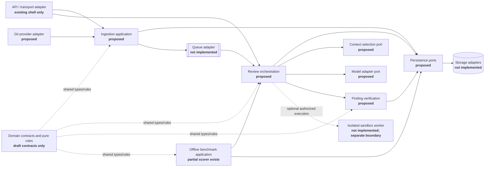

# Modular Application Boundaries and Proposed Interfaces

**Status:** Proposed module/interface specification for ARCH-003. It is not an implemented package layout or evidence that the interfaces are already enforced.

## Decision

Start with a **modular monolith for trusted control-plane logic**, with narrow ports around external services and persistence. Isolate untrusted-code execution in a separate sandbox worker only after its security boundary is implemented and independently tested. Do not start with a fleet of independently deployed microservices: the repository has no operational foundation for that complexity, and the proposed ports permit extraction later without coupling domain logic to vendors.

The diagram shows logical dependencies and data flow, not current deployment:

## Proposed ports and contracts

The signatures below are language-neutral contract sketches, not importable Python interfaces. `Ref` means an opaque, tenant-scoped identifier. `Result<T, E>` means a typed success or a typed failure; implementations must not encode errors as empty success values. Domain payloads are versioned records. ARCH-002 added draft Python dataclasses for several records, but those records and tests remain **unverified/TODO**, are not integrated, and are not normative wire formats until validated and versioned compatibility is specified.

| Boundary | Owning module and proposed operations | Input → output | Key guarantees / failure cases |
|---|---|---|---|
| **Integration** | `GitProviderPort.verify_delivery(raw_headers, raw_body)`, `fetch_pull_request(repo_ref, number, expected_head?)`, `fetch_file(snapshot_ref, path)`. A separate internal read model exposes `ReviewResultReader.get_review_result(run_ref)` to the UI. Any future `PRReviewPublisher.publish_review(review_ref, authorization)` is a separate, disabled-by-default write-capable port. | Untrusted HTTP/provider bytes → authenticated delivery or normalized provider data; run reference → internal read-only result, or explicitly authorized publish receipt. | Verify signature and installation/repository authorization before accepting events; bound payloads; preserve delivery identity; provider errors/rate limits are typed. Default is read-only; publishing requires distinct least-privilege authorization. No merge/approval capability. Adapters own vendor SDK/API details and do not set policy. |
| **Ingestion** | `IngestionUseCase.accept_delivery(verified_delivery)`, `capture_snapshot(repository_ref, pr_number, expected_head?)`. Depends on provider-read, deduplication, snapshot-persistence, and queue ports. | Authenticated, authorized event → accepted/replayed/rejected outcome and immutable snapshot reference, or typed failure. | Idempotent on provider delivery identity; bind base/head/merge-base, PR identity, acquisition time and content digest to the exact snapshot. Detect missing/truncated inputs and report them; do not replace a changed head silently. Never execute repository content. |
| **Orchestration** | `ReviewUseCase.start(snapshot_ref, policy_ref, config_ref)`, `get(run_ref)`, `cancel(run_ref)`. Depends on context, model, analyzer, verifier, policy/persistence and job-queue ports. | Exact snapshot and policy/config revisions → run reference and lifecycle status; stage outcomes → partial/completed/failed result. | Owns workflow, budgets, deadlines, cancellation and state transitions, not provider-specific logic. Bind every stage and output to the same immutable snapshot/run. Missing/failed/skipped checks remain explicit; “no finding” is not a safety claim. |
| **Context** | `ContextProvider.select(snapshot_ref, changed_scope, review_hypothesis?, token_budget)`. | Exact immutable snapshot plus scope/budget → context pack. | Each item carries snapshot identity, repository-relative path, line range or symbol, content digest, retrieval reason, and provenance. Enforce access/policy and size limits; return partial/unavailable reasons. Treat repository instructions/content as untrusted data. Never fetch an arbitrary path outside the snapshot or execute code. |
| **Model adapters** | `ModelReviewer.review(request, deadline, cancellation)`. Adapter factory/capability inspection is separate from the review call. | Versioned review request with minimum permitted context → untrusted candidate findings, provider/model identity, usage, or typed timeout/rate-limit/auth/invalid-output/provider error. | Provider credentials remain adapter-owned; normalize provider errors and usage without vendor-specific leakage. Enforce deadline/cancellation and output-size/schema validation. Model output is a candidate, never a verified finding or authority to invoke tools. |
| **Finding verification** | `FindingVerifier.verify(snapshot_ref, policy_ref, candidates, tool_results)`. | Candidate findings and check outcomes tied to exact run/snapshot → accepted, rejected, duplicate, or unverified findings plus explicit check/coverage status. | Validate schema, evidence references, snapshot identity, policy, severity, duplicate control, path and changed-line anchors. Do not invent anchors or treat model confidence as truth. A verifier cannot upgrade absent evidence/checks into a pass. |
| **Benchmark** | `BenchmarkRunner.run(frozen_manifest, candidate_config, budget)`, `BenchmarkScorer.score(adjudicated_matches, predictions, clean_controls)`. | Immutable dataset/config manifest and candidate → versioned run record, preserved failures/raw outputs, then metrics only from documented/adjudicated matches. | Offline evaluation is separate from product publication and production state. Record dataset/snapshot/config/provider/prompt/tool versions, budgets, sampling, exclusions and failures. Do not tune on protected holdouts; do not infer semantic matches from the scorer. |
| **Persistence** | `SnapshotStore.put_immutable(snapshot)`, `get_snapshot(snapshot_ref)`; `ReviewStore.create_run/get_run/append_event`, `PolicyStore.get_revision`, `BenchmarkStore.save_run/get_run`. Transactional and query details are adapter-specific. | Validated tenant-scoped domain records/references → durable references or typed not-found/conflict/unavailable errors. | Enforce tenant scope on every operation; snapshot records are immutable; run/policy/config revision links are stable; event/audit append semantics are explicit. Queue messages contain identifiers, not source payloads or credentials. Never expose raw source in ordinary operational logs. Retention, deletion, encryption and migrations require separate decisions. |

## Shared interface rules

1. **Dependency direction:** transport and vendor adapters call application use cases; application use cases depend on domain contracts and declared ports; adapters implement ports. Domain/context/verification code must not import FastAPI, vendor SDKs, database drivers, queue clients, or deployment configuration.
2. **No hidden side effects:** pure parsing, context ranking, normalization and verification are deterministic functions over explicit inputs where feasible. Network, persistence, queueing, model calls, publishing and sandbox invocation occur only behind declared ports.
3. **Identity binding:** every result carries or references run and immutable snapshot identities plus applicable policy/config/schema revisions. Cross-run or stale-snapshot evidence is rejected or marked unverified.
4. **Typed outcomes:** distinguish invalid/unauthorized input, not found, conflict/stale identity, unavailable dependency, rate limit, timeout/cancellation, partial input, and internal failure. No exception is converted into an empty successful review.
5. **Data and privilege separation:** repository, model, analyzer and sandbox outputs are untrusted data. Read-only Git access is the default; write capability is separate and not part of MVP review. No service handling untrusted data can access deployment secrets it does not need.
6. **Execution boundary:** the API/orchestrator never executes repository commands. Any test/fix execution is a separate, explicitly authorized job in an independently validated ephemeral sandbox with resource limits, restricted egress and no developer/production credentials. That sandbox is not implemented.
7. **Versioning:** schemas/ports carry explicit version identities. The draft `contracts.py` uses version string `1.0.0`, but serialization, compatibility negotiation, persistence migrations, and evolution policy are not yet defined; see ARCH-004. Do not assume Python dataclass shape is a stable wire contract.

## Module ownership and dependency rules

| Logical module | Owns | May depend on | Must not own |
|---|---|---|---|
| Domain contracts/core rules | Versioned record shapes, enums, state/validation primitives, pure review invariants | Standard library and stable abstractions | Frameworks, I/O, provider clients, mutable global state |
| Transport/API | HTTP validation, authentication handoff, response mapping | Ingestion/review use cases | Review policy decisions, provider SDK logic, repository execution |
| Integration adapters | Provider-specific authentication/API translation and bounded publication | Declared integration ports, provider SDK | Domain state machine, arbitrary write/merge permissions |
| Ingestion | Event idempotency and immutable snapshot workflow | Provider-read and persistence/queue ports | Model prompts, finding ranking |
| Orchestration | Review lifecycle, stage graph, budget/deadline/cancellation | Domain contracts and context/model/analyzer/verifier/persistence/queue ports | Vendor-specific payloads, direct database/HTTP clients |
| Context | Snapshot-scoped retrieval and provenance | Snapshot/read ports and deterministic ranking | Model calls, external repository access outside authorized adapter |
| Model adapters | Provider request/response translation | Model port and provider client | Verification, policy override, Git writes |
| Verification | Candidate validation, anchors, evidence, duplicates, check status | Domain contracts and exact snapshot/policy data | Model/provider clients, persistence driver |
| Benchmark | Frozen run orchestration, matching/scoring/report artifacts | Review use case in offline mode, benchmark persistence | Production PR publishing, silent holdout tuning |
| Persistence adapters | Durable storage and tenant-scoped queries | Persistence ports and chosen DB/object store | Business workflow or trust decisions |
| Sandbox adapter/worker | Explicitly authorized isolated execution and bounded outputs | Sandbox job/result port | API-process execution, credentials, unrestricted egress |

The composition root selects concrete adapters and wires dependencies. Do not allow adapters to import one another directly to bypass application interfaces. Queue, database, model provider, Git provider and sandbox technologies remain replaceable decisions; this document selects boundaries, not products.

## Existing code versus proposed boundaries

| Observed path | What exists now | Boundary implication |
|---|---|---|
| `src/reviewforge/api.py` | FastAPI health endpoint and changed-line parser endpoint; response explicitly says review was not performed and provider is not configured. | A transport/API shell only. It does not implement ingestion, run orchestration, persistence, or provider integration. |
| `src/reviewforge/diff.py` | Dependency-free unified-diff added-line parser and `ChangedLine` dataclass. | A small deterministic utility; not a context engine, full snapshot parser, or analyzer adapter. |
| `src/reviewforge/benchmark/metrics.py` | Scorer for supplied adjudicated match IDs and metrics. | Partial benchmark/scoring utility; no benchmark runner, matcher, dataset control, or report pipeline. |
| `src/reviewforge/contracts.py` | Draft versioned domain dataclasses added for ARCH-002, with regression tests not yet executed. | Proposed domain types only; currently unverified, not a stable serialization contract, and not consumed by other modules. ARCH-002 remains TODO. |
| `src/reviewforge/` overall | No ingestion, orchestration, context engine, model adapter, finding verifier, Git integration, persistence adapter, or sandbox module observed. | The interfaces in this document are proposed and unimplemented. No runtime conformance is claimed. |

## Acceptance coverage and open decisions

This specification defines an owner and explicit operations, inputs/outputs, dependencies, and key failure/security constraints for all eight required areas: ingestion, orchestration, context, model adapters, finding verification, benchmark, integration, and persistence. That is design evidence for ARCH-003 only; it is not implementation or interface-conformance evidence.

Before implementation, resolve or record: concrete transport/persistence/queue/provider choices; tenant identity and authorization model; durable event/idempotency semantics; source retention/deletion and encryption; model-provider data handling; external integration read/write permission split; and the isolated sandbox technology/security proof. ARCH-002 must be validated before treating its Python records as executable contracts. ARCH-004 must establish wire compatibility and migration rules. ARCH-003 does not close either task.
