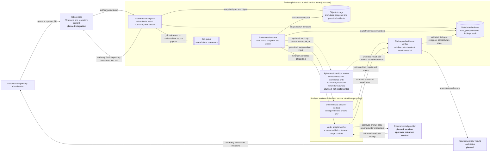
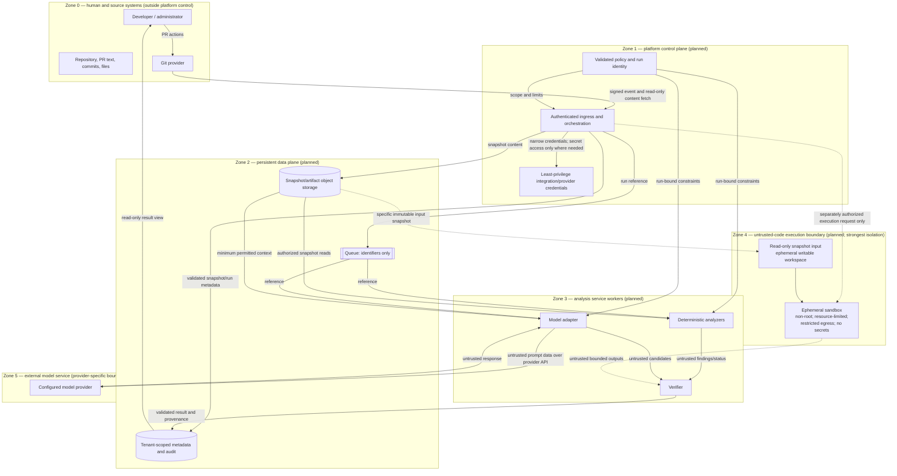

# System Context and Trust Boundaries

**Status:** Proposed architecture, informed by the current scaffold. This document is a design artifact, not evidence that the depicted integrations, infrastructure, or controls are deployed or working.

## 1. System context and intended data flows

The diagram describes the intended read-only-by-default review flow. Boxes marked **planned** are not implemented in this repository. The existing API/parser/scorer code is shown separately in the implementation inventory below.

### Flow constraints

1. The provider event is authenticated and authorized before a run is created. Fetches are read-only and bind the run to immutable base/head identities; a changed head is a different snapshot/run.
2. Store source snapshots separately from operational metadata. Queue messages carry identifiers, not source contents or credentials. Storage, retention, encryption, and tenant-isolation implementations remain design/implementation work.
3. Repository files, PR descriptions, model responses, analyzer output, and sandbox output are untrusted **data**, never authority to change policy, permissions, or tool access. The verifier checks candidates against the exact snapshot and reports failed, skipped, partial, and unavailable checks explicitly.
4. The model adapter sends only the minimum context permitted by the selected policy and provider configuration. Provider credentials stay in a service-side secret boundary and are not exposed to repository content, the model prompt, or workers that do not need them.
5. The API/orchestrator does not execute repository scripts. Static analyzers must be explicitly configured and bounded; commands that execute repository-controlled code belong only in the separately isolated sandbox. The sandbox is not a general networked worker.
6. The default result path is read-only. Any future write-back to the Git provider requires separate explicit authorization and least-privilege scope; automatic approval or merge is out of scope.
7. “No finding” means only “not detected by checks actually run.” Missing context, failed tools, unsupported inputs, timeout, or sandbox unavailability are unverified/partial outcomes, not passes.

## 2. Trust zones and crossings

### Boundary rules and current confidence

| Crossing / zone | Required rule | Current status |
|---|---|---|
| Git provider → ingress | Verify provider authentication/signature, installation/repository authorization, payload limits, and replay/idempotency before accepting work. Fetch least privilege. | Requirement/design only; no provider integration is present in the inspected scaffold. |
| Repository content → any service/worker | Treat content as adversarial data. Do not let embedded instructions authorize tools, expose secrets, or change scope. Validate paths, anchors, schemas, and permissions server-side. | Security rules are documented in `docs/SECURITY_BOUNDARIES.md`; comprehensive runtime enforcement is not evidenced. |
| Service → storage/queue | Tenant-scope access; bind records to immutable snapshot/run IDs and policy/config revisions. Queue payloads should contain references, not credentials or source dumps. | Proposed architecture; no database, object storage, or queue implementation is present. |
| Worker → model provider | Use approved minimum context and a service-owned credential; enforce deadlines, output validation, and provider/data-retention policy. Treat model output as untrusted. | No model adapter/provider is present. Provider retention and data-residency decisions remain unresolved. |
| Analyzer → repository code | Static analysis is distinct from executing repository-controlled commands. Do not run repository scripts in the API/orchestrator. | Current source has diff parsing but no analyzer execution integration. |
| Repository code → sandbox | Only an explicitly authorized job may cross. Require ephemeral isolation, resource limits, restricted egress, no developer/production secrets, and bounded artifact return. | Sandbox is not implemented or verified; no untrusted repository code may be run until this boundary exists and passes security tests. |
| Results → developer/Git provider | Validate evidence/anchors and report check status and uncertainty. Default to read-only; no automatic merge. | Current API explicitly says its diff parsing is not a review; no result publishing path is present. |

## 3. What exists versus what is proposed

Observed in source during this task:

- `src/reviewforge/api.py` is a small FastAPI shell with health and changed-line parsing endpoints. Its health response says the review provider is not configured; the parsing endpoint says no review was performed.
- `src/reviewforge/diff.py` parses added lines from unified diffs. It is not a language-aware analyzer or Git integration.
- `src/reviewforge/benchmark/metrics.py` scores supplied, adjudicated finding matches. It does not run a review or perform semantic matching.

The Git provider integration, durable metadata/object storage, queue, orchestration, analyzer/model workers, verifier, user-facing review surface, and sandbox in the diagrams are **planned components, not implemented or deployed components**. The diagrams do not establish their security properties, availability, tenant isolation, or accuracy. `MASTER_PLAN.md` describes PostgreSQL/object storage, a Redis-or-equivalent queue, modular workers, and a future sandbox as proposed options; final technology choices and deployment topology remain open.

## 4. Acceptance coverage and unresolved architecture risks

The two diagrams identify the human/repository actors, Git and model providers, metadata and object storage, queue, analyzer and model workers, sandbox, trust zones, and labeled data flows. This is sufficient evidence for the ARCH-001 documentation acceptance only.

Material unresolved details to settle before implementation include:

- Exact authentication, webhook replay handling, permissions, tenant model, and provider installation lifecycle.
- Selected storage/queue technologies, encryption/key ownership, retention/deletion, backup/restore, and consistency guarantees.
- Whether analysis workers are dedicated per job or shared, and which static analyzers are allowed to process repository content outside the sandbox.
- Sandbox technology and proof of isolation, resource enforcement, restricted egress, secret absence, and artifact sanitation.
- Model-provider retention, data residency, allowed data, and credential isolation.
- Deployment topology and the specific identity/authorization checks at each service boundary.

These are not silently decided by the diagrams. Until the sandbox and service boundaries are implemented and tested, executing untrusted repository code remains prohibited.
